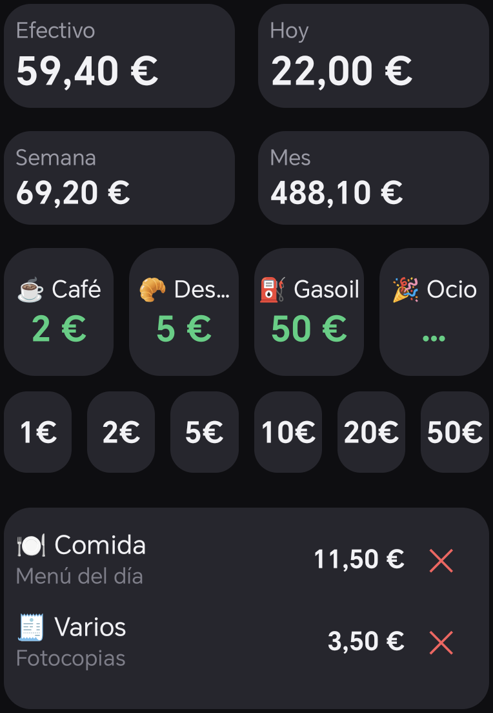
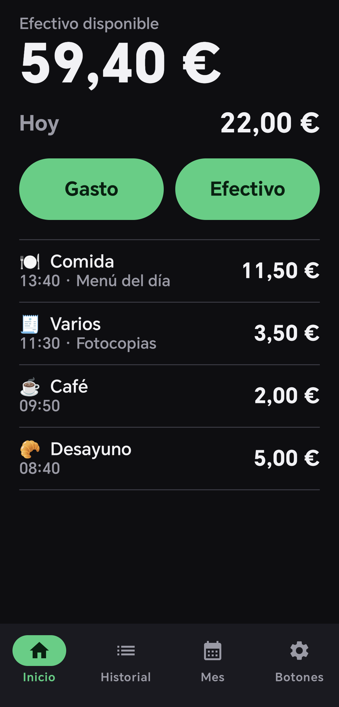
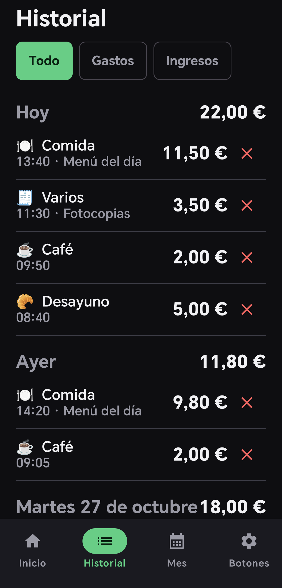
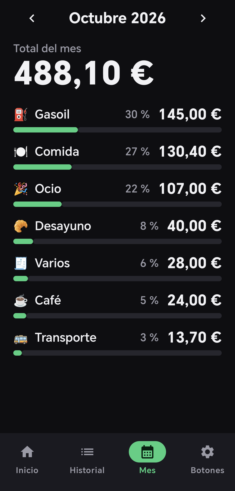
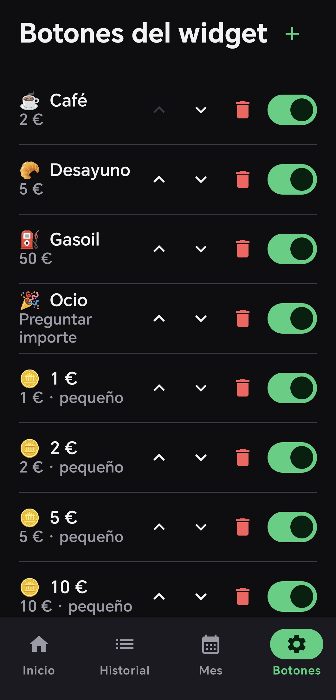

# Efectivo

App Android para llevar el control del dinero en efectivo desde un widget del escritorio.
Sin cuentas, sin red y sin nube: todo vive en una base de datos local del móvil.

El objetivo es la velocidad. Apuntar un gasto desde el widget cuesta **un toque**, o dos si
el importe es variable. No hay confirmaciones ni diálogos por medio.

## Qué hace

- **Registrar un gasto con un toque** desde el widget, sin abrir la app.
- **Saldo en efectivo siempre a la vista**, junto al gasto de hoy, de la semana y del mes.
- **Botones configurables**: etiqueta, emoji e importe fijo, o "preguntar importe".
- **Historial del día en el propio widget**, con una ✕ por fila para corregir errores.
- **Resumen mensual** por categoría, con importes y porcentajes.
- **Entradas de efectivo** (retirada del cajero) y correcciones a la baja.

<p align="center">
  
</p>

<p align="center">
  
  
  
  
</p>

<p align="center"><sub>Widget · Inicio · Historial · Mes · Botones (con datos inventados)</sub></p>

## Código abierto e instalación del APK

Efectivo es software libre, con licencia [MIT](LICENSE): puedes usarlo, modificarlo y
repartirlo. El APK ya compilado está en la página de
[Releases](https://github.com/JoaquinJBG/efectivo-widget/releases).

1. Descarga `efectivo-v1.1-debug.apk` desde el móvil.
2. Android pedirá permiso para instalar apps de orígenes desconocidos para el navegador o
   el gestor de archivos que lo haya descargado (`Ajustes` → `Seguridad` o `Aplicaciones` →
   *Instalar apps desconocidas*). Concédelo solo a esa app.
3. Abre el APK e instala. Luego pon el widget (más abajo, en *Cómo se instala*).

**Sobre la firma.** Es un APK de depuración: está firmado con la clave de depuración del PC
donde se compiló, no con una clave de release, y la app no está en Play Store. Android solo
deja instalar una actualización encima de otra si las dos llevan la misma firma, así que las
actualizaciones oficiales tienen que firmarse con esa misma clave, es decir, compilarse en
el PC del autor. Si compilas tú el proyecto, tu APK llevará otra clave y no se instalará
encima del de la Release: habría que desinstalar antes, y como la app no exporta datos
(`allowBackup=false`), se perderían los movimientos.

## Decisiones de diseño

**El saldo nunca se guarda.** Se calcula siempre como `suma(entradas de efectivo) −
suma(gastos)`. Guardarlo habría abierto la puerta a que se desincronizara con los
movimientos que lo componen.

**Un botón es su categoría.** Al crear un botón se crea su categoría; al renombrarlo se
renombra; al borrarlo se *archiva*, no se borra, para que los gastos que ya tenía sigan
mostrando su nombre en el historial y en el resumen del mes. Los botones de moneda son la
excepción: comparten categoría, porque si cada uno tuviera la suya el resumen mensual se
llenaría de "1 €", "2 €", "5 €" en vez de agruparlos.

**Teclado numérico propio.** El del sistema tarda en aparecer y eso se nota cuando lo único
que quieres es escribir "12,50" y cerrar.

**Protección contra el doble toque.** Repintar un widget no es instantáneo. Un segundo toque
impaciente llegaba antes de que el primero enseñara nada y apuntaba el gasto dos veces sin
avisar, así que los toques repetidos sobre el mismo control dentro de 1,5 s se descartan.

## Stack

| Pieza | Versión |
|---|---|
| Kotlin | 2.4.20 (integrado en AGP) |
| AGP | 9.4.1 |
| Gradle | 9.6.0 |
| JDK | 17 |
| compileSdk / targetSdk | 37 |
| minSdk | 26 |
| Compose BOM | 2026.09.00 |
| Room | 2.8.5 |
| Glance | 1.2.0 |
| KSP | 2.3.12 |

## Estructura

```
app/src/main/java/io/github/joaquinjbg/efectivo/
├── data/          Room: entidades, DAOs y repositorio
├── ui/
│   ├── home/      Saldo, gasto de hoy y lista del día
│   ├── history/   Gastos por día, con edición y borrado
│   ├── month/     Resumen mensual por categoría
│   ├── settings/  Botones del widget: añadir, editar, borrar, reordenar
│   ├── quick/     Diálogo transparente que abre el widget
│   └── common/    Teclado numérico, chips de categoría, hoja de entrada
├── widget/        Widget Glance: cabecera, botones e historial
└── util/          Importes, fechas, vibración y medición de tiempos
```

## Modelo de datos

| Entidad | Contenido |
|---|---|
| `Expense` | Importe en céntimos, categoría, fecha, nota, origen (`WIDGET` \| `APP`) |
| `CashMovement` | Entradas de efectivo; en negativo, correcciones |
| `Category` | Nombre, emoji, orden y marca de archivada |
| `QuickButton` | Botón del widget: etiqueta, emoji, categoría e importe fijo u opcional |

La base de datos va por la versión 3, con migraciones escritas a mano: `compact` en los
botones (v2) y `archived` en las categorías (v3). Los esquemas se exportan a
`app/schemas/`.

## Cómo se compila

```bash
gradlew testDebugUnitTest assembleDebug
```

El APK sale en `app/build/outputs/apk/debug/app-debug.apk`.

Desde VS Code, `Ctrl+Shift+B` compila e instala de una vez. Las tareas están en
`.vscode/tasks.json` y llevan dentro las rutas del JDK y del SDK.

## Cómo se instala

**Por cable:**

```bash
adb install -r app\build\outputs\apk\debug\app-debug.apk
```

**Por Wi-Fi**, en el móvil: `Opciones de desarrollador` → `Depuración inalámbrica` →
*Vincular dispositivo con código*. Desde el PC:

```bash
adb pair <ip>:<puerto-de-vinculacion> <codigo>
adb connect <ip>:<puerto-de-conexion>
```

El puerto de conexión no es el de vinculación; `adb mdns services` lo encuentra. Luego,
`scripts/instalar.ps1` se encarga de todo: busca el móvil, ignora los emuladores y avisa
con un mensaje claro si no hay ninguno conectado.

**Poner el widget:** mantén pulsado un hueco del escritorio → `Widgets` → `Efectivo`.

## Cómo se usa

1. Toca un botón del widget y el gasto queda apuntado. El saldo y los totales se
   actualizan solos.
2. Si el botón no tiene importe, se abre un teclado numérico con su categoría ya elegida.
3. ¿Te has equivocado? La ✕ de esa línea del historial lo borra.
4. Los botones se configuran en la app, pestaña `Botones`.
5. El aspecto del widget se retoca en un solo fichero: **`widget/WidgetStyle.kt`**, con
   todos los colores, tamaños y separaciones comentados y sin nada de lógica.

## Tests

28 tests unitarios sobre el repositorio, que corren en la JVM con dobles en memoria de los
DAO de Room: cálculo del saldo, límites de día, semana y mes, desglose mensual, borrado por
id y el ciclo de vida de botones y categorías.

```bash
gradlew testDebugUnitTest
```

## Medir el widget

El widget lleva instrumentación de tiempos, apagada salvo que se active:

```bash
adb shell setprop log.tag.EfectivoPerf DEBUG
adb logcat -v time | grep EfectivoPerf
```

Registra el ciclo toque → escritura → repintado, y el tamaño y el reparto que resuelve en
cada composición. Medido en un Honor con Android 16, el ciclo completo tarda **18–45 ms**.

## Notas sobre Glance, aprendidas a golpes

- **Solo trae layouts de contenedor para 10 hijos como máximo**, y descarta el resto en
  silencio, sin error ni aviso. Si desaparecen elementos del final de una fila o una
  columna, es esto. Por eso cada banda del widget vive en su contenedor anidado.
- **Los huecos se hacen con `Spacer`, no con `padding`.** No existe `.margin()`, y dos
  `padding` encadenados **no se suman**: el de dentro anula al de fuera. Un
  `padding(end = 40.dp)` sobre un hijo que ya tiene relleno propio no hace absolutamente
  nada.
- **`SizeMode.Exact`, no `Responsive`.** Responsive obliga al launcher a elegir entre unos
  tamaños declarados, y en un plegable escogía uno mucho menor que el hueco real.
- **RemoteViews no puede medirse a sí mismo**, así que el reparto vertical usa
  estimaciones en dp de lo que ocupa cada bloque.
- **Vibrar desde el callback de un widget** requiere `VibrationAttributes.USAGE_TOUCH`: el
  proceso está en segundo plano y Android descarta las vibraciones sin un *usage* válido.

## Lo que no se pudo

**El widget no llega a ancho y alto máximos a la vez en MagicOS.** Se dejó la declaración
idéntica a la del widget grande de WPS —el único del dispositivo que sí lo consigue—
atributo por atributo, y el launcher sigue dando 4 columnas a uno y 5 al otro. Medido con
`uiautomator dump`: WPS ocupa 1006 × 1722 px y este 800 × 1722, con el mismo alto. También
se probó a registrar el provider con otro nombre, por si el launcher cacheaba los límites.
No hay nada más que tocar en `appwidget-provider`.

## Fuera de alcance

Sincronización, copias de seguridad, varias monedas, presupuestos y alertas, inicio de
sesión, diseño para tabletas y publicación en Play Store.

## Licencia

[MIT](LICENSE).
